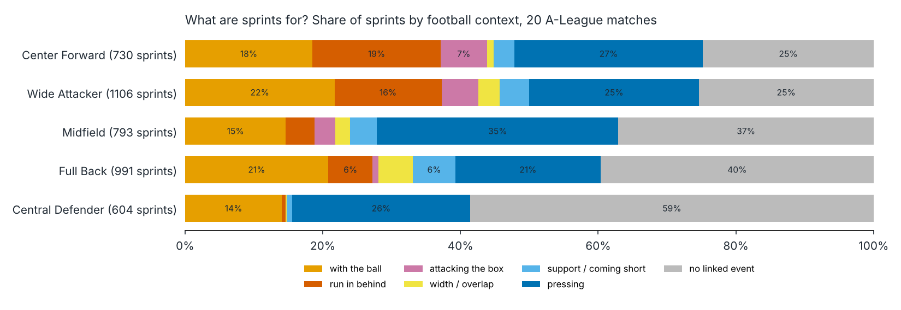
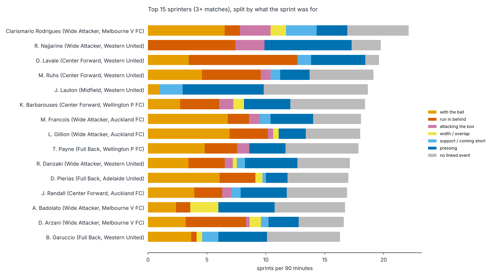
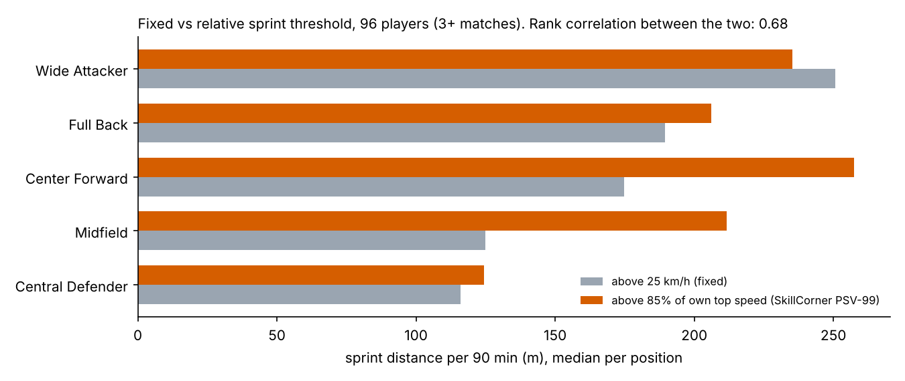
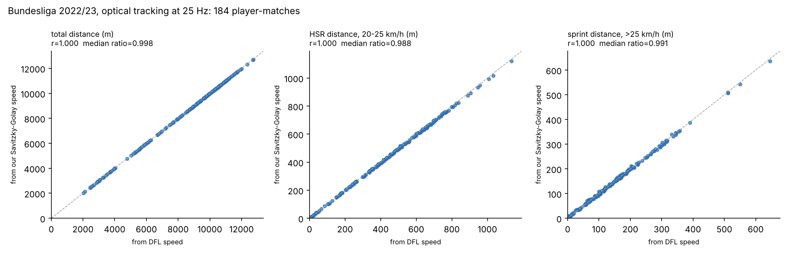

# Football tracking: physical metrics from raw positions

Distance, high-speed running, sprints and accelerations for every player, computed from raw tracking data (x, y positions, 10 to 25 times per second), checked against the providers' own numbers on 27 matches from two leagues, then linked to what happens on the pitch: is a sprint a run in behind, a press, a carry, a recovery run?

Most football analytics repos start from metrics someone else already computed. This one starts from positions, treats speed and acceleration as a signal processing problem, and measures how far the result is from the reference before using it.

Data, two leagues kept apart because the providers and their stats differ:

| | A-League 2024/25 | Bundesliga 2022/23 (1st and 2nd division) |
|---|---|---|
| source | [SkillCorner Open Data](https://github.com/SkillCorner/opendata), MIT | [IDSSE dataset](https://doi.org/10.1038/s41597-025-04505-y), DFL / Sportec Solutions, CC-BY 4.0 |
| matches, players | 20, 271 | 7, 164 |
| tracking | broadcast video, 10 Hz, 43% of positions extrapolated (off camera) | optical (TRACAB), 25 Hz, every player always tracked |
| events | off-ball runs, pressing, passes, shots | passes, shots with xG, duels, aerial duels, tackles |
| reference to validate against | SkillCorner season aggregates | DFL speed published for every frame |

**Live app: [pl-sch-football.streamlit.app](https://pl-sch-football.streamlit.app)** (player profiles, match tables, comparisons, with the stats you pick).

## Quick start

```bash
pip install -r requirements.txt
bash scripts/fetch_idsse.sh                       # Bundesliga files from Hugging Face (2.6 GB, optional)
python src/footperf/sportec_convert.py data/idsse # XML -> compact CSV, standard library only
python scripts/run_all.py                 # all matches: physical + technical stats, validation (A-League ~1.8 GB download)
python scripts/bundesliga_check.py        # our speed vs the DFL's, add --window-scan for the smoothing test
python scripts/sprint_context.py          # what each sprint was for
python scripts/relative_thresholds.py     # fixed vs player-relative sprint threshold
python scripts/run_match.py --match 1886347   # one match in detail, with signal figures
python scripts/sensitivity.py --match 1886347 # effect of the smoothing window
streamlit run app/streamlit_app.py
pytest
```

Without the Bundesliga files, `run_all.py` simply runs on the A-League. Downloads are cached in `data/` (not in git). Results are written to `outputs/` and committed, so the app runs without downloading anything.

## Pipeline

1. **Load** the JSONL tracking into a long table: frame, player, x, y, visible or extrapolated, which team has the ball.
2. **Speed and acceleration** with a Savitzky-Golay derivative (window 9 frames, order 2), on contiguous frames only. A player who disappears for 5 s and reappears 30 m away does not get a fake sprint.
3. **Speed zones** with SkillCorner's definitions: running 15-20 km/h, HSR 20-25 km/h, sprint above 25 km/h, an action counts if held 0.7 s, accelerations beyond ±3 m/s².
4. **Possession split**: distance with the team in and out of possession.
5. **Technical stats** from SkillCorner dynamic events: passes (successful or not), shots, possessions lost, off-ball runs and whether a pass targeted them, pressing actions, regains. There are no tackles or headers in this data.
6. **Effort context**: each run above 20 km/h is matched to the event of the same player overlapping it in time (possession > off-ball run > pressing).
7. **Validation** against SkillCorner's season aggregates for the same players.

## Does it measure the right thing?

The reference is a per-player season average. A ratio near 1 means no systematic bias; the correlation says whether players are ranked the same way. Players appear in 1 to 7 of the 20 matches, so the comparison is made match by match and pooled per player.

| metric | r, one match (mean of 20) | r, pooled 3+ matches (94 players) | ratio, pooled |
|---|---|---|---|
| metres per minute | 0.89 | 0.93 | 0.82 |
| m/min, team in possession | 0.82 | 0.87 | **1.01** |
| m/min, team out of possession | 0.87 | 0.95 | **0.99** |
| running distance (15-20 km/h) | 0.89 | 0.96 | 0.87 |
| HSR distance (20-25 km/h) | 0.77 | 0.87 | 0.95 |
| sprint distance (>25 km/h) | 0.73 | 0.81 | 1.04 |
| HSR count | 0.78 | 0.82 | 0.92 |
| sprint count | 0.70 | 0.77 | 1.16 |
| high accelerations | 0.56 | 0.69 | 1.18 |
| high decelerations | 0.71 | 0.76 | 1.07 |
| top speed vs PSV-99 | 0.44 | 0.64 | 1.06 |


What this shows:

- **Pooling raises every correlation.** With 5+ matches (only 14 players) distances reach r = 0.96 to 0.99 and sprint counts 0.85. Most of the single-match gap is sampling noise: a player makes about 10 sprints a match.
- **The overall metres-per-minute bias (0.82) disappears once split by possession (1.01 and 0.99).** The missing distance is covered when nobody has the ball, which is exactly when the broadcast shows replays and close-ups. See point 1 below.
- **HSR count was fixed by the definition, not by more data.** Counting "one run above 20 km/h = one effort" gave a ratio of 0.64 that pooling never moved. Counting each stay in the 20-25 km/h band, as SkillCorner describes, brings it to 0.92. The old count is kept as `hsr_effort_count` for comparison.
- **Sprint counts are 16% high** and accelerations 18% high. Open question; likely spikes on extrapolated frames.
- **Top speed stays the weakest metric.** Half the players have a PSV-99 between 27.5 and 29 km/h, so an error of 1 km/h is enough to reshuffle the ranking.

## What are sprints for?



Across 4,229 sprints: 26% are pressing, 18% with the ball, 10% runs in behind, and 36% overlap no event. Those unlinked sprints happen out of possession 58% of the time: mostly recovery runs and tracking back, which SkillCorner does not label as events.

The profiles differ sharply by position. A centre-back's sprints are 59% unlinked and almost never runs in behind. Centre-forwards make 19% of their sprints in behind and 7% attacking the box. Midfielders press the most (35%). Of the runs in behind made at sprint speed, 43% were targeted by a pass.



Two wingers with the same sprint count can be very different players: R. Najjarine (Western United) sprints in behind and presses; Clarismario Rodrigues (Melbourne Victory) sprints with the ball.

## Fixed or relative sprint threshold?

25 km/h is 81% of the top speed of a 31 km/h winger but 96% of a 26 km/h midfielder's. Counting distance above 85% of each player's own top speed (SkillCorner PSV-99) instead of a fixed 25 km/h:



The rank correlation between the two is 0.68: a third of the ordering changes. Midfielders go from last but one to level with full-backs; wide attackers lose first place to centre-forwards. Which threshold is "right" depends on the question: fixed for comparing the physical demand of roles, relative for how often a player works near his own limit. This uses speed histograms saved per match, so any threshold can be tested without reprocessing the tracking.

## Bundesliga: an exact check on optical tracking

The A-League check compares one match with a season average, which is indirect. The DFL data allows a direct one: the provider publishes its own speed for every player at every frame, so distances computed from our Savitzky-Golay speed can be compared with distances from theirs, player by player, match by match.



Over 184 player-matches: total distance 0.998 of the provider's, HSR distance 0.988, sprint distance 0.991, correlation 1.000 on all three. Sprint, HSR and acceleration counts on one match are within 2% of the counts obtained with the provider's speed.

The smoothing window that suits broadcast data is wrong for optical data. With 0.9 s, chosen on the A-League, sprint distance comes out 4% low: the filter shaves the peaks. Clean 25 Hz positions need less smoothing.

| Savitzky-Golay window | 0.28 s | 0.44 s | 0.60 s | 0.92 s | 1.24 s |
|---|---|---|---|---|---|
| sprint distance, ratio to DFL | 1.007 | 0.994 | 0.983 | 0.963 | 0.923 |
| HSR distance, ratio to DFL | 0.993 | 0.989 | 0.983 | 0.955 | 0.932 |

The pipeline uses 0.44 s for optical tracking and 0.9 s for broadcast tracking. The right filter depends on the noise of the source, not on football.

The DFL events also bring what SkillCorner's lack: duels with a winner and a loser, aerial duels (headers), tackles, and xG per shot. They are in the app under "Bundesliga". With 7 matches, all involving Fortuna Düsseldorf, these are illustrations, not league-wide conclusions.

## Three things the data taught me

**1. Broadcast tracking loses players a quarter of the time.** On match 1886347, 26% of frames are empty: replays and close-ups, mostly during stoppages, when players walk. Dividing distance by *tracked* minutes inflates intensity by 15%. Dividing by minutes played is fair but misses the low-speed distance covered off-camera. The possession split above confirms it: within live play, the bias is gone.

**2. Acceleration counts are a processing choice as much as a physical fact.** Distances barely move with the smoothing window. Acceleration counts collapse (match 1886347):

| Savitzky-Golay window (frames) | 5 | 9 | 13 | 17 | 21 |
|---|---|---|---|---|---|
| high accel, ratio to SkillCorner | 1.92 | 1.12 | 0.45 | 0.22 | 0.00 |
| HSR distance, ratio | 1.07 | 1.06 | 1.02 | 0.98 | 0.93 |

The default of 9 frames was chosen because it matches SkillCorner on accelerations for this match. Acceleration results are therefore calibrated, not independently validated.


**3. Extrapolated positions can be physically impossible.** Only 59% of player positions are seen by the camera; the rest are extrapolated. One winger reached 44.9 km/h on extrapolated frames, faster than Usain Bolt's peak. Top speed is computed on visible frames only, held for 0.7 s.

## App

`app/streamlit_app.py` reads the CSV files in `outputs/`. Pick the league at the top; each league shows the stats its provider records.

- **Player**: percentiles against players in the same position, sprint map filtered by context, match-by-match table with the stats you choose.
- **Match**: both teams, chosen stats, totals or per 90 minutes.
- **Compare players**: any two stats against each other, coloured by position.

## Layout

```
src/footperf/
  data.py         download and parse SkillCorner files
  kinematics.py   Savitzky-Golay speed and acceleration, gap handling
  physical.py     speed zones, efforts, possession split, speed histograms
  events.py       technical stats and effort context from dynamic events
  sportec.py      Bundesliga (DFL / IDSSE): players, tracking, events, provider speed check
  sportec_convert.py  streaming XML -> CSV converter, standard library only
  pipeline.py     one match end to end with caching, pooling across matches
  validation.py   comparison with SkillCorner season aggregates
  viz.py          figures (matplotlib only)
scripts/          run_all, run_match, sprint_context, relative_thresholds, sensitivity,
                  bundesliga_check, fetch_idsse.sh
app/              Streamlit explorer
tests/            synthetic trajectories with known answers
```

## Limits and next steps

- Small samples: 20 A-League matches (1 to 7 per player), 7 Bundesliga matches all involving Fortuna Düsseldorf.
- No free tracking data exists for Ligue 1. The 2022 World Cup (PFF FC, free on registration) is the next candidate.
- Degrade the Bundesliga data to 10 Hz with broadcast-like noise and gaps, to measure how much of the A-League error comes from the source rather than the method.
- Find where the 16% excess in sprint counts comes from (extrapolated frames are the first suspect).
- Event data with tackles, duels and headers (e.g. StatsBomb) exists for other competitions, not for these matches.
- Physical output by game state: winning, drawing, losing.

## Sources

- SkillCorner Open Data, github.com/SkillCorner/opendata
- Bassek, M. et al. (2025). An integrated dataset of synchronized spatiotemporal and event data in elite soccer. Scientific Data. doi.org/10.1038/s41597-025-04505-y
- SkillCorner metric definitions (HSR 20-25 km/h, sprint >25 km/h, sustained 0.7 s): skillcorner.com/blog/seasonality
