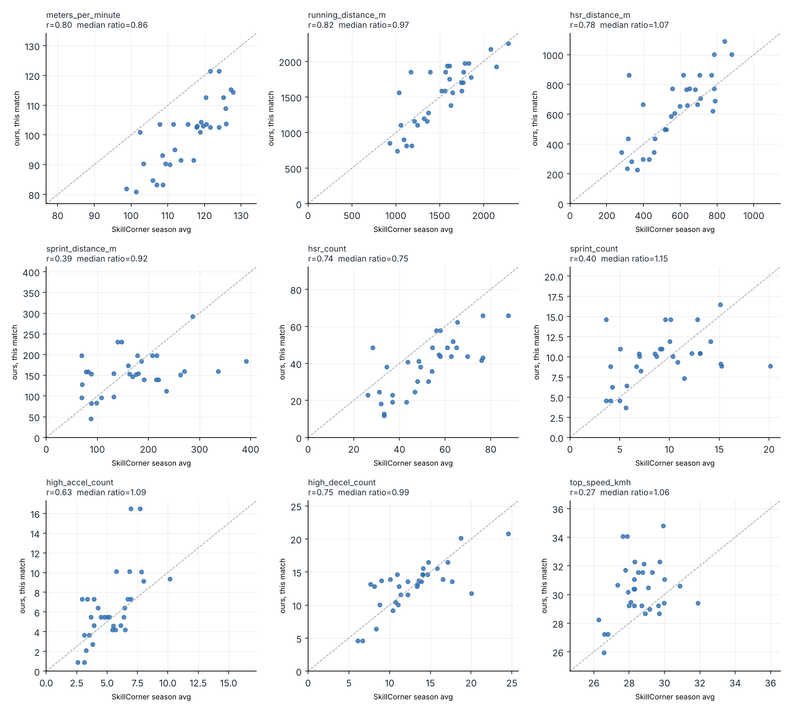

# Football tracking: physical metrics from raw positions

Distance, high-speed running, sprints and accelerations for every player, computed from raw broadcast tracking (x, y at 10 Hz). Then checked against the provider's own published numbers.

Most football analytics repos start from metrics someone else already computed. This one starts from positions, derives speed and acceleration as a signal processing problem, and measures how far the result is from the reference.

Data: [SkillCorner Open Data](https://github.com/SkillCorner/opendata), Australian A-League 2024/25 (MIT licence). First match analysed: Auckland FC 2-0 Newcastle Jets, 30 Nov 2024 (id `1886347`).

## Quick start

```bash
pip install -r requirements.txt
python scripts/run_match.py --match 1886347   # downloads ~90 MB on first run
python scripts/sensitivity.py --match 1886347
pytest
```

Outputs go to `outputs/<match_id>/`: per-player table, every high-intensity effort with start/end position, validation tables and figures.

## Pipeline

1. **Load** the JSONL tracking into a long table (frame, player, x, y, detected).
2. **Speed and acceleration** with a Savitzky-Golay derivative (window 9 frames, order 2), computed only on contiguous frames. A player who disappears for 5 s and reappears 30 m away does not get a fake sprint.
3. **Speed zones** using SkillCorner's definitions: running 15-20 km/h, HSR 20-25 km/h, sprint above 25 km/h, efforts held at least 0.7 s, accelerations beyond ±3 m/s².
4. **Efforts**: one continuous stretch above 20 km/h is one effort. It is a sprint if it holds 25 km/h for 0.7 s, otherwise HSR. This classification is my convention; SkillCorner does not publish theirs.
5. **Validation** against SkillCorner's season aggregates for the same players (32 players with 45+ minutes).

## Results on match 1886347



| metric | median ratio (ours / SkillCorner) | Pearson r |
|---|---|---|
| metres per minute | 0.86 | 0.80 |
| running distance (15-20 km/h) | 0.97 | 0.82 |
| HSR distance (20-25 km/h) | 1.07 | 0.78 |
| sprint distance (>25 km/h) | 0.92 | 0.39 |
| HSR count | 0.75 | 0.74 |
| sprint count | 1.15 | 0.40 |
| high accelerations | 1.09 | 0.63 |
| high decelerations | 0.99 | 0.75 |
| top speed vs PSV-99 | 1.06 | 0.27 |

Read with care: the reference is a season average, ours is one match. A ratio near 1 means no systematic bias. The correlation says whether players are ranked the same way.

What holds: volume metrics (distance, running, HSR distance) are unbiased and rank players like SkillCorner does.

What doesn't, yet:

- **Sprints and top speed correlate poorly (r ≈ 0.3 to 0.4).** A player makes about 10 sprints a match. With counts that small, one game says little about a season, so part of this is sampling noise. The test is to run all available matches and average per player. Not done yet.
- **HSR count is 25% low while HSR distance is right.** My "one run = one effort" rule merges what SkillCorner probably counts as several efforts.
- **Metres per minute is 14% low.** See below.

## Three things the data taught me

**1. Broadcast tracking loses players a quarter of the time.** 26% of frames are empty: replays and close-ups. Those happen mostly during stoppages, when players walk. Dividing distance by *tracked* minutes inflates intensity by 15% (155 m/min for the top midfielder, unrealistic). Dividing by minutes played gives 114 m/min, plausible, but misses the low-speed distance covered off-camera. That is the 0.86 ratio.

**2. Acceleration counts are a processing choice as much as a physical fact.** Distances barely move with the smoothing window. Acceleration counts collapse:

| Savitzky-Golay window | 5 | 9 | 13 | 17 | 21 |
|---|---|---|---|---|---|
| high accel, ratio to SkillCorner | 1.84 | 1.09 | 0.43 | 0.19 | 0.00 |
| HSR distance, ratio | 1.08 | 1.07 | 1.03 | 0.99 | 0.93 |

The default window of 9 frames was chosen because it matches SkillCorner on accelerations. So the acceleration row in the results table is calibrated on this match, not independently validated.


The positions are already smoothed upstream (top panel: raw and smoothed speed overlap). Acceleration, a second derivative, still carries noise (bottom panel).

**3. Extrapolated positions can be physically impossible.** Only 59% of player positions are actually seen by the camera; the rest are extrapolated. One winger reached 44.9 km/h on extrapolated frames, faster than Usain Bolt's peak. Top speed is therefore computed on visible frames only, held for 0.7 s. During sprints players are visible 87% of the time, so sprint detection is less exposed than the overall figure suggests.


## Layout

```
src/footperf/
  data.py         download and parse SkillCorner files
  kinematics.py   Savitzky-Golay speed and acceleration, gap handling
  physical.py     speed zones, effort detection, per-player summary
  validation.py   comparison with SkillCorner season aggregates
  viz.py          figures (matplotlib only)
scripts/
  run_match.py    full pipeline for one match
  sensitivity.py  smoothing window x minutes denominator grid
tests/            synthetic trajectories with known answers
```

## Next steps

- Run every available match, average per player, and check whether sprint correlations rise. If they do, the gap was sampling noise. If not, it is the method.
- Split metrics in and out of possession (the aggregates have `_tip` / `_otip` columns).
- Link efforts to SkillCorner's dynamic events: which sprints lead to a pass option, a shot, a recovery.
- Speed thresholds relative to each player's top speed instead of fixed 20/25 km/h.

## Sources

- SkillCorner Open Data, github.com/SkillCorner/opendata
- SkillCorner metric definitions (HSR 20-25 km/h, sprint >25 km/h, sustained 0.7 s): skillcorner.com/blog/seasonality
