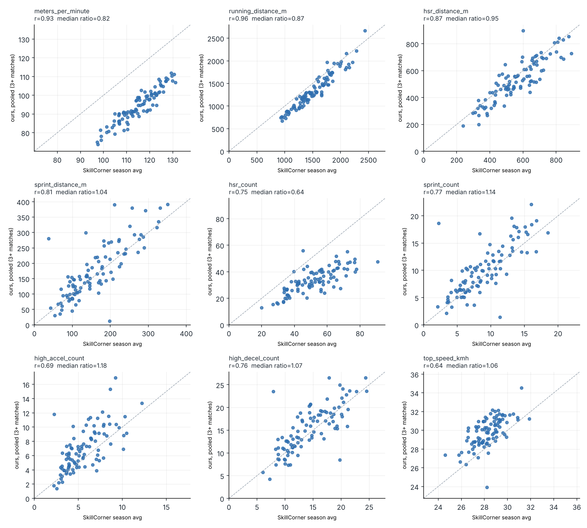
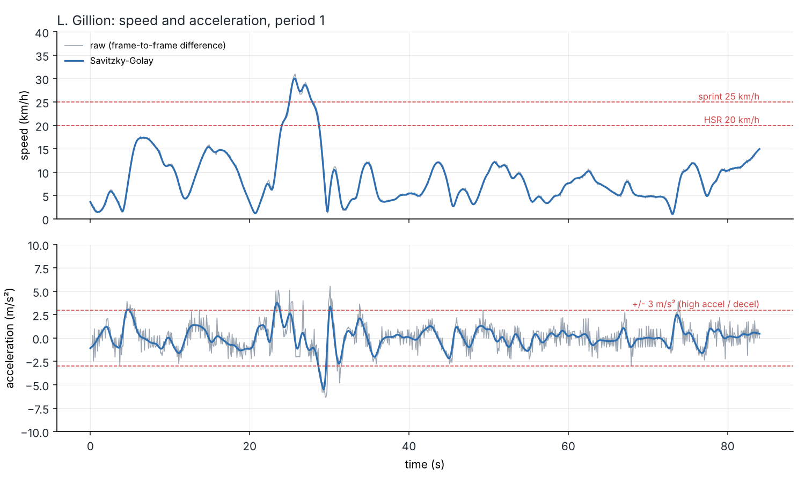
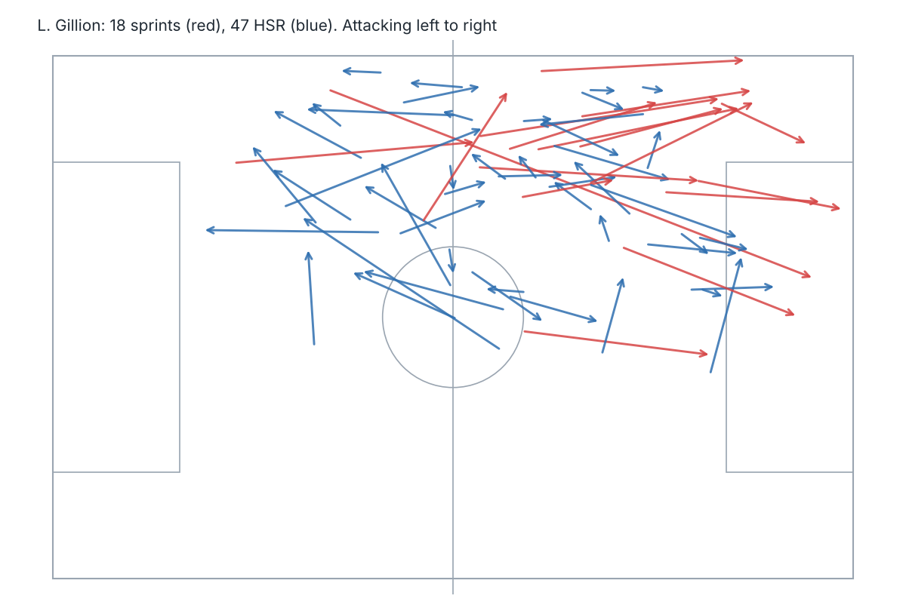

# Football tracking: physical metrics from raw positions

Distance, high-speed running, sprints and accelerations for every player, computed from raw broadcast tracking (x, y at 10 Hz). Then checked against the provider's own published numbers, on 20 matches.

Most football analytics repos start from metrics someone else already computed. This one starts from positions, derives speed and acceleration as a signal processing problem, and measures how far the result is from the reference.

Data: [SkillCorner Open Data](https://github.com/SkillCorner/opendata), Australian A-League 2024/25, 20 matches, 271 players (MIT licence).

## Quick start

```bash
pip install -r requirements.txt
python scripts/run_match.py --match 1886347   # one match, all figures (~90 MB download)
python scripts/run_all.py                     # all 20 matches + pooled validation (~1.8 GB)
python scripts/sensitivity.py --match 1886347 # effect of the smoothing window
pytest
```

Outputs go to `outputs/<match_id>/` (per-player table, every high-intensity effort with start/end position) and `outputs/all_matches/` (all players, all matches, pooled validation). Downloads are cached in `data/`, results in `outputs/`: a second run takes about a minute.

## Pipeline

1. **Load** the JSONL tracking into a long table (frame, player, x, y, detected).
2. **Speed and acceleration** with a Savitzky-Golay derivative (window 9 frames, order 2), computed only on contiguous frames. A player who disappears for 5 s and reappears 30 m away does not get a fake sprint.
3. **Speed zones** using SkillCorner's definitions: running 15-20 km/h, HSR 20-25 km/h, sprint above 25 km/h, efforts held at least 0.7 s, accelerations beyond ±3 m/s².
4. **Efforts**: one continuous stretch above 20 km/h is one effort. It is a sprint if it holds 25 km/h for 0.7 s, otherwise HSR. This classification is my convention; SkillCorner does not publish theirs.
5. **Validation** against SkillCorner's season aggregates for the same players.

## Results

The reference is a per-player season average. A ratio near 1 means no systematic bias. The correlation says whether players are ranked the same way.

### One match against a season average

First pass on match 1886347 (Auckland FC 2-0 Newcastle Jets), then the same comparison repeated on each of the 20 matches.

| metric | ratio, match 1886347 | r, match 1886347 | r, mean over 20 matches |
|---|---|---|---|
| metres per minute | 0.86 | 0.90 | 0.89 |
| running distance (15-20 km/h) | 0.96 | 0.91 | 0.89 |
| HSR distance (20-25 km/h) | 1.06 | 0.88 | 0.77 |
| sprint distance (>25 km/h) | 0.90 | 0.56 | 0.73 |
| HSR count | 0.76 | 0.80 | 0.66 |
| sprint count | 1.13 | 0.57 | 0.70 |
| high accelerations | 1.12 | 0.66 | 0.56 |
| high decelerations | 0.98 | 0.77 | 0.71 |
| top speed vs PSV-99 | 1.07 | 0.43 | 0.44 |

Volumes hold up. Sprints and top speed look weak. Two possible explanations: a player makes about 10 sprints a match, so one game is a noisy sample of his season; or the method is off. Pooling matches separates the two.

### Pooled over several matches per player

Sum each player's distances, counts and minutes over every match he appears in, then compare.

| metric | r, single match | r, pooled 3+ matches (94 players) | r, pooled 5+ matches (14 players) | ratio, pooled 3+ |
|---|---|---|---|---|
| metres per minute | 0.89 | 0.93 | 0.99 | 0.82 |
| running distance | 0.89 | 0.96 | 0.99 | 0.87 |
| HSR distance | 0.77 | 0.87 | 0.96 | 0.95 |
| sprint distance | 0.73 | 0.81 | 0.86 | 1.04 |
| HSR count | 0.66 | 0.75 | 0.90 | **0.64** |
| sprint count | 0.70 | 0.77 | 0.85 | 1.14 |
| high accelerations | 0.56 | 0.69 | 0.92 | 1.18 |
| high decelerations | 0.71 | 0.76 | 0.97 | 1.07 |
| top speed vs PSV-99 | 0.44 | 0.64 | 0.39 | 1.06 |



Every correlation rises with more matches, so most of the single-match gap was sampling noise, not the method. Two things do not move:

- **HSR count stays at 0.64.** More data does not fix a bias. My "one run = one effort" rule merges what SkillCorner counts as separate HSR efforts. That is a definition gap, and the next thing to fix.
- **Top speed stays weak.** Half the players have a PSV-99 between 27.5 and 29 km/h, so an error of 1 km/h is enough to reshuffle the ranking. The 5+ match figure rests on 14 players and should not be read alone.

## Three things the data taught me

**1. Broadcast tracking loses players a quarter of the time.** On match 1886347, 26% of frames are empty: replays and close-ups. They happen mostly during stoppages, when players walk. Dividing distance by *tracked* minutes inflates intensity by 15% (155 m/min for the top midfielder, unrealistic). Dividing by minutes played gives 114 m/min, plausible, but misses the low-speed distance covered off-camera. That is the 0.82-0.86 ratio on metres per minute.

**2. Acceleration counts are a processing choice as much as a physical fact.** Distances barely move with the smoothing window. Acceleration counts collapse (match 1886347):

| Savitzky-Golay window (frames) | 5 | 9 | 13 | 17 | 21 |
|---|---|---|---|---|---|
| high accel, ratio to SkillCorner | 1.92 | 1.12 | 0.45 | 0.22 | 0.00 |
| HSR distance, ratio | 1.07 | 1.06 | 1.02 | 0.98 | 0.93 |

The default window of 9 frames was chosen because it matches SkillCorner on accelerations for this match. So acceleration results are calibrated, not independently validated.



The positions are already smoothed upstream (top panel: raw and smoothed speed overlap). Acceleration, a second derivative, still carries noise (bottom panel).

**3. Extrapolated positions can be physically impossible.** Only 59% of player positions are actually seen by the camera; the rest are extrapolated. One winger reached 44.9 km/h on extrapolated frames, faster than Usain Bolt's peak. Top speed is therefore computed on visible frames only, held for 0.7 s. During sprints players are visible 87% of the time, so sprint detection is less exposed than the overall figure suggests.



## Layout

```
src/footperf/
  data.py         download and parse SkillCorner files
  kinematics.py   Savitzky-Golay speed and acceleration, gap handling
  physical.py     speed zones, effort detection, per-player summary
  pipeline.py     one match end to end with caching, pooling across matches
  validation.py   comparison with SkillCorner season aggregates
  viz.py          figures (matplotlib only)
scripts/
  run_match.py    one match, all figures
  run_all.py      every match, pooled validation
  sensitivity.py  smoothing window x minutes denominator grid
tests/            synthetic trajectories with known answers
```

## Next steps

- Fix the HSR count definition: count each entry into the 20-25 km/h band, then check the ratio moves to 1.
- Link efforts to SkillCorner's dynamic events (off-ball runs, pressing, possessions): which sprints are runs in behind, which are pressing.
- Split metrics in and out of possession (the aggregates have `_tip` / `_otip` columns).
- Speed thresholds relative to each player's top speed instead of fixed 20/25 km/h.

## Sources

- SkillCorner Open Data, github.com/SkillCorner/opendata
- SkillCorner metric definitions (HSR 20-25 km/h, sprint >25 km/h, sustained 0.7 s): skillcorner.com/blog/seasonality
